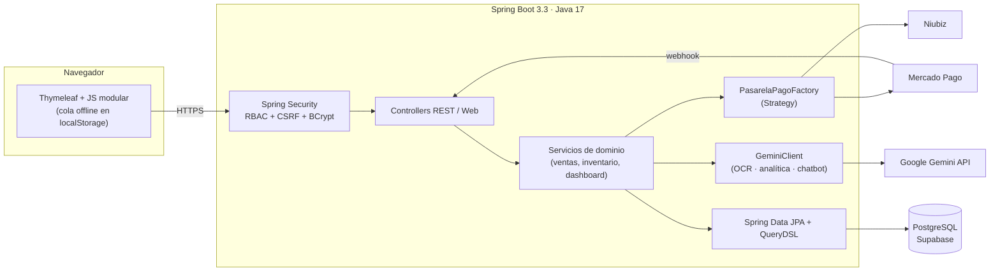

<div align="center">

# POS SaaS Multi-Tenant + IA

**Plataforma de punto de venta en la nube para pequeños negocios: varias empresas en una sola instancia, pagos QR, analítica con IA y modo offline parcial.**

[](https://github.com/PrzStkJs/POS-SaaS-Multi-Tenant/actions/workflows/ci.yml)


[](LICENSE)

[Demo en video](https://vimeo.com/1215131349) · [Portafolio](https://przstkjs.github.io/Portafolio-Perez/)

</div>

---

## El problema

Las bodegas, minimarkets y farmacias suelen llevar caja, inventario, cobros y reportes en herramientas separadas. El resultado: stock descuadrado, poca visibilidad de lo que se vende y ventas perdidas cuando se cae internet.

## La solución

Un POS SaaS donde cada empresa trabaja aislada dentro de la misma aplicación, con:

- **Ventas y caja** con control de stock en tiempo real y anulación de ventas.
- **Cobros QR** con Mercado Pago y Niubiz, y confirmación automática por **webhooks**.
- **IA con Google Gemini**: lectura OCR de facturas de proveedores, reportes ejecutivos, chatbot corporativo y sugerencias de *cross-selling*.
- **Proyección de demanda** e inventario crítico en el dashboard.
- **Modo offline parcial**: las ventas en efectivo se guardan en el navegador y se sincronizan al volver la conexión.

---

## Arquitectura



### Decisiones de diseño

| Decisión | Por qué |
| :--- | :--- |
| **Multi-tenant por discriminador (`empresaId`)** | Una sola base y un solo despliegue para todos los clientes. Cada consulta toma la empresa del usuario autenticado (`SecurityUtils.getCurrentEmpresaId()`), nunca de un parámetro enviado por el cliente. |
| **Pasarelas de pago con patrón Strategy + Factory** | `PasarelaPagoService` define el contrato y `PasarelaPagoFactory` elige la implementación (Mercado Pago, Niubiz o manual). Agregar una pasarela nueva es crear una clase, sin tocar el flujo de venta. |
| **Confirmación de pago por webhook** | El estado de la venta se actualiza cuando la pasarela confirma, no cuando el cliente dice que pagó. |
| **Una API key de Gemini por caso de uso** | OCR, analítica y chatbot usan claves y modelos separados: se controlan costos y límites por función. |
| **Secretos solo en variables de entorno** | Ninguna credencial vive en el repositorio. Ver [`.env.example`](pos/.env.example). |

### Roles

| Rol | Acceso |
| :--- | :--- |
| `SUPER_ADMIN` | Alta y configuración de empresas del SaaS. |
| `ADMIN` | Dashboard, productos, stock, usuarios, promociones y analítica de su empresa. |
| `CAJERO` | Pantalla de ventas y cobros. |

---

## Stack

| Capa | Tecnologías |
| :--- | :--- |
| Backend | Java 17, Spring Boot 3.3, Spring Security, Spring Data JPA, Hibernate, QueryDSL, Bean Validation |
| Base de datos | PostgreSQL (Supabase) |
| Integraciones | Mercado Pago SDK, Niubiz, Google Gemini API, ZXing (QR), springdoc OpenAPI |
| Frontend | Thymeleaf, JavaScript modular, Bootstrap 5, Chart.js |
| DevOps | Maven, Docker, GitHub Actions |

---

## Ejecutar en local

**Requisitos:** Java 17 y una base PostgreSQL (local o Supabase).

```bash
git clone https://github.com/PrzStkJs/POS-SaaS-Multi-Tenant.git
cd POS-SaaS-Multi-Tenant/pos

# 1. Configura las variables de entorno (ver .env.example)
export DB_USERNAME=...
export DB_PASSWORD=...
export GEMINI_API_KEY_CHATBOT=...
export GEMINI_API_KEY_OCR=...
export GEMINI_API_KEY_ANALITICA=...
export MP_ACCESS_TOKEN=...

# 2. Arranca la aplicación
./mvnw spring-boot:run
```

La aplicación queda en `http://localhost:8080`. La documentación de la API (springdoc) está en `/swagger-ui.html` tras iniciar sesión.

### Con Docker

```bash
cd pos
docker build -t pos-saas .
docker run -p 8080:8080 --env-file .env pos-saas
```

### Variables de entorno

| Variable | Uso |
| :--- | :--- |
| `DB_USERNAME`, `DB_PASSWORD` | Credenciales de PostgreSQL |
| `GEMINI_API_KEY_CHATBOT` | Chatbot corporativo |
| `GEMINI_API_KEY_OCR` | Lectura de facturas |
| `GEMINI_API_KEY_ANALITICA` | Reportes y analítica |
| `MP_ACCESS_TOKEN` | Access token de Mercado Pago |

> La URL de la base se define en `pos/src/main/resources/application.properties`; cámbiala por la tuya.

---

## Estructura

```
pos/src/main/java/com/BarCodeSys/pos
├── config/        # Jackson, QueryDSL
├── controller/    # REST y vistas: ventas, inventario, dashboard, IA, webhooks
├── dto/           # Contratos de entrada y salida
├── exceptions/    # Errores de dominio
├── models/        # Entidades JPA: Empresa, Usuario, Producto, Venta...
├── repository/    # Spring Data JPA
├── security/      # SecurityConfig, UsuarioPrincipal, SecurityUtils (tenant actual)
└── service/       # Lógica de negocio, pasarelas de pago y clientes de IA
```

---

## Próximos pasos

- [ ] Verificación de firma en los webhooks de Mercado Pago.
- [ ] Pruebas de integración con Testcontainers (PostgreSQL).
- [ ] Migraciones versionadas con Flyway en lugar de `ddl-auto`.
- [ ] Reemplazar la cola offline de `localStorage` por IndexedDB.

---

## Autor

**Jesús Alexander Pérez** — Backend Developer (Java / Spring Boot · Python)

[LinkedIn](https://www.linkedin.com/in/alexander-perez-b154683b1) · [Portafolio](https://przstkjs.github.io/Portafolio-Perez/) · [GitHub](https://github.com/PrzStkJs)

Distribuido bajo licencia [MIT](LICENSE).
